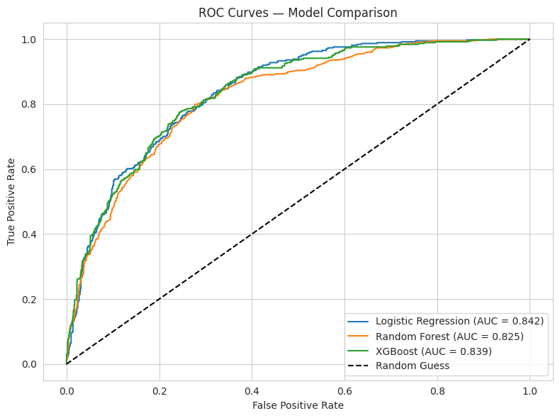
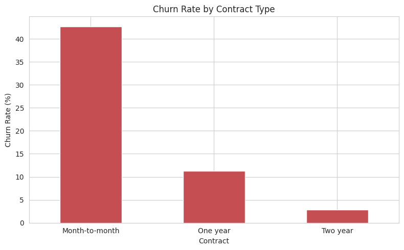
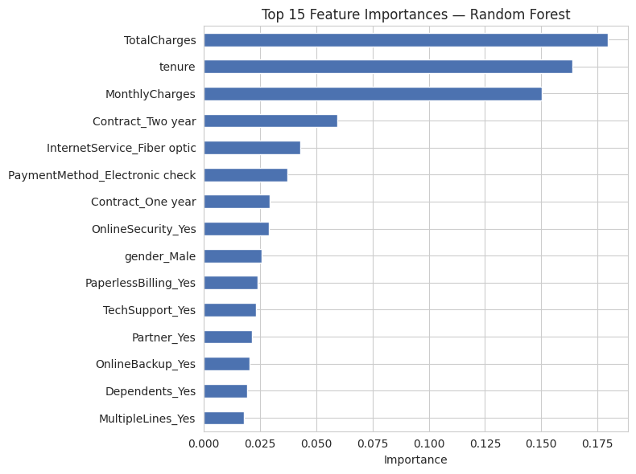

# Customer Churn Prediction

Predicting which telecom customers are likely to leave, and identifying what drives churn, using Python and machine learning.

## Overview
Customer churn is costly for subscription businesses, so identifying at-risk customers early lets a company target retention efforts. This project builds and compares three classification models on the IBM Telco Customer Churn dataset and turns the findings into practical recommendations.

## Dataset
- **Source:** [Telco Customer Churn (Kaggle)](https://www.kaggle.com/datasets/blastchar/telco-customer-churn)
- **Size:** 7,043 customers, 21 columns
- **Target:** `Churn` (Yes/No). About 26.5% of customers churned, so the classes are imbalanced.

## Approach
1. **Data cleaning:** fixed 11 hidden blank values in `TotalCharges` (new customers with 0 tenure) and dropped `customerID`.
2. **Exploratory analysis:** churn compared against contract type, tenure, monthly charges, and payment method.
3. **Preprocessing:** one-hot encoding, stratified 80/20 train/test split, scaling of numeric features.
4. **Modelling:** Logistic Regression, Random Forest, and XGBoost, with class weighting to handle the imbalance.
5. **Evaluation:** accuracy, precision, recall, F1-score, ROC-AUC, and confusion matrix.
6. **Interpretation:** feature importance and model coefficients.

## Results
| Model | Accuracy | Precision (Churn) | Recall (Churn) | F1 (Churn) | ROC-AUC |
|---|---|---|---|---|---|
| Logistic Regression | 0.738 | 0.504 | 0.783 | 0.614 | **0.842** |
| Random Forest | 0.790 | 0.633 | 0.497 | 0.557 | 0.825 |
| XGBoost | 0.752 | 0.521 | **0.786** | **0.627** | 0.839 |

Random Forest has the highest accuracy but misses about half of the customers who churn, so accuracy alone is misleading here.



## Key Findings
- **Contract type:** month-to-month customers churn at 42.7%, versus 11.3% (one-year) and 2.8% (two-year).
- **Tenure:** churn is concentrated in the first months of service.
- **Payment method:** electronic-check customers churn at 45.3%, far above automatic payment methods.
- **Charges:** churned customers pay more per month on average.




## Recommendations
- Run an onboarding or loyalty programme for the first 12 months.
- Offer incentives to move month-to-month customers to longer contracts.
- Encourage automatic payment and investigate the electronic-check experience.
- Bundle online security and tech support into plans.
- Score customers regularly and send the highest-risk group to a retention team.

## Tech Stack
Python, Pandas, NumPy, Matplotlib, Seaborn, Scikit-learn, XGBoost, Jupyter Notebook

## How to Run
```bash
git clone https://github.com/munjalisha10-hub/Customer-Churn-Prediction.git
cd Customer-Churn-Prediction
pip install -r requirements.txt
jupyter notebook churn_prediction.ipynb
```

## Limitations and Future Work
- Single snapshot dataset; results show association, not causation.
- Models were not extensively tuned; cross-validation and hyperparameter search would be a next step.
- Possible extensions: SHAP explanations, cost-based threshold selection, and deployment as a small web app.
